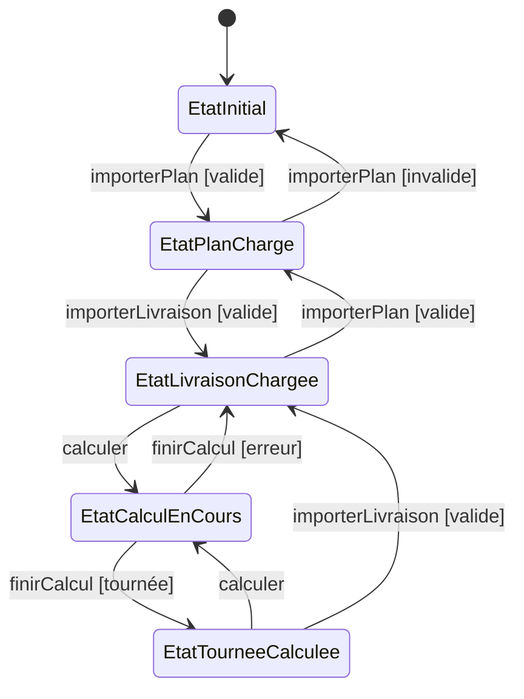
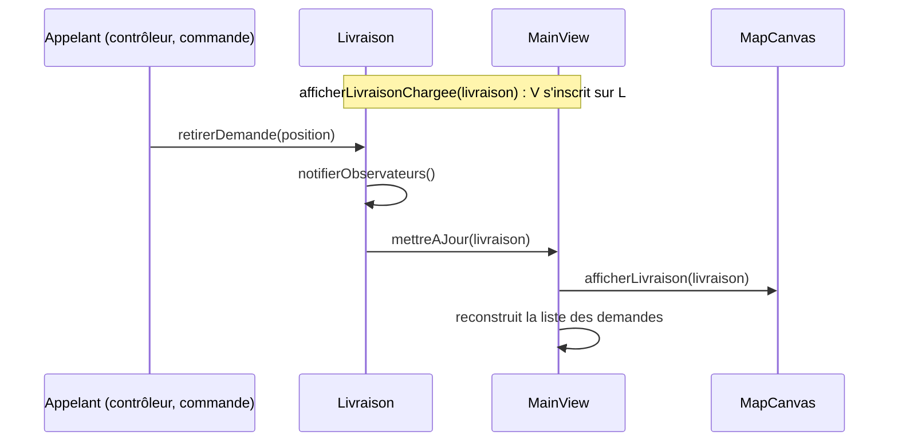
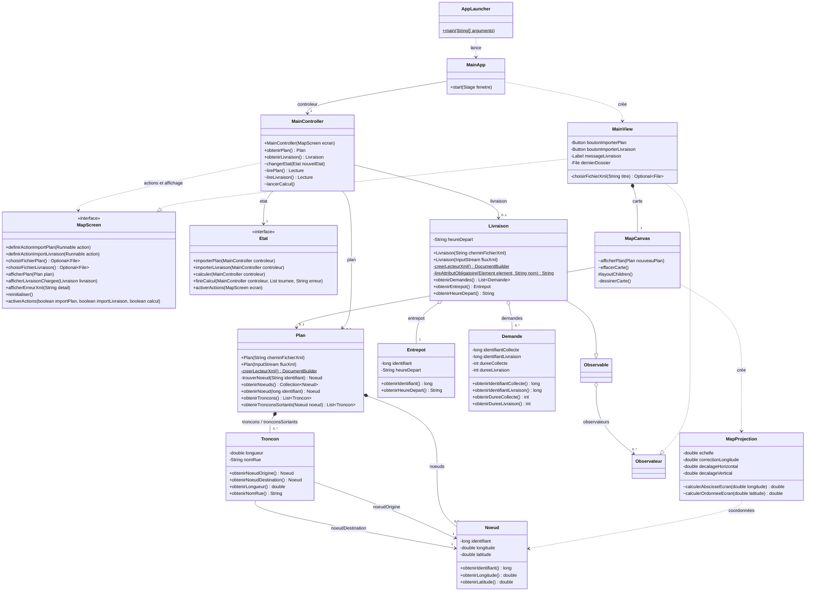
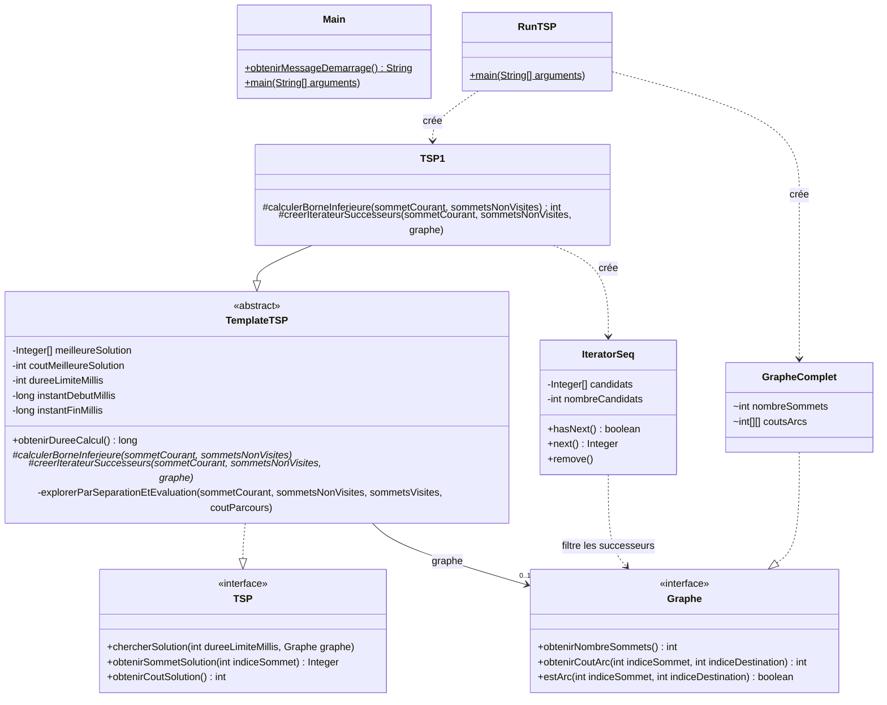
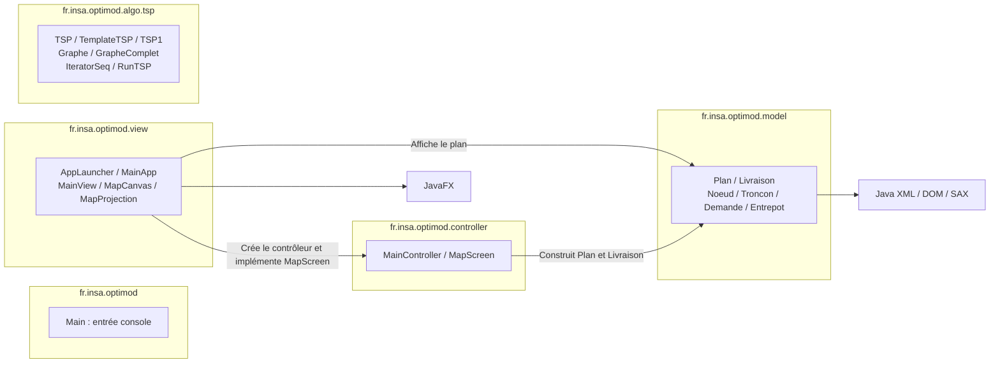

# Livrables UML actualisés

Ces diagrammes décrivent les deux cas d'utilisation implémentés et les noms
français du code. Les blocs Mermaid sont affichables sur GitHub ou dans un
lecteur Markdown compatible. Les fichiers PlantUML servent de sources d'export.

Les noms des classes et packages sont conservés. Les méthodes imposées par Java
ou JavaFX (`main`, `start`, `layoutChildren`, `hasNext`, `next`, `remove`) et les
appels aux bibliothèques externes gardent leur nom. Le code pédagogique original
de `docs/code-fourni` est conservé ; sa copie applicative est renommée.

## Charger et afficher le plan

Source détaillée : [sequence-chargement-plan.puml](sequence-chargement-plan.puml).

```mermaid
sequenceDiagram
    autonumber
    actor U as Utilisateur
    participant V as MainView
    participant C as MainController
    participant P as Plan
    participant M as MapCanvas
    participant R as MapProjection
    Note over V,C: definirActionImportPlan(action) branche le bouton
    U->>V: Cliquer sur Importer le Plan
    V->>C: importerPlan(ecran) via l'action enregistrée
    C->>V: choisirFichierPlan()
    V->>V: choisirFichierXml(titre)
    V-->>C: Optional de fichier
    alt Annulation
        Note over V,C: État précédent conservé
    else Fichier sélectionné
        C->>P: new Plan(cheminFichierXml)
        P->>P: creerLecteurXml().parse(fichier)
        P->>P: Plan(documentXml)
        Note right of P: Créer les Noeud, puis les Troncon<br/>Résoudre les extrémités avec trouverNoeud(identifiant)
        alt Lecture réussie
            P-->>C: Plan construit
            Note right of C: plan = résultat ; livraison = null
            C->>V: afficherPlan(plan)
            V->>M: afficherPlan(plan)
            M->>M: dessinerCarte()
            M->>P: obtenirNoeuds(), obtenirTroncons()
            P-->>M: Collections du plan
            M->>R: new MapProjection(noeuds, largeur, hauteur, margeInterieure)
            loop Coordonnées des nœuds et des tronçons
                M->>R: calculerAbscisseEcran(longitude)
                M->>R: calculerOrdonneeEcran(latitude)
                R-->>M: Coordonnées en pixels
            end
            M-->>U: Carte affichée
            Note right of V: Effacer messageLivraison<br/>Activer boutonImporterLivraison
            Note right of C: etat = EtatPlanCharge
        else Erreur de lecture
            P-->>C: IOException, SAXException ou IllegalArgumentException
            C->>V: afficherErreurXml(erreur.getMessage())
            V-->>U: Alerte XML invalide
            Note right of C: plan = null ; livraison = null
            C->>V: reinitialiser()
            V->>M: effacerCarte()
            Note right of V: Effacer le message et désactiver l'import des livraisons
            Note right of C: etat = EtatInitial
        end
    end
```

## Charger la livraison

Source détaillée :
[sequence-chargement-livraison.puml](sequence-chargement-livraison.puml).

```mermaid
sequenceDiagram
    autonumber
    actor U as Utilisateur
    participant V as MainView
    participant C as MainController
    participant L as Livraison
    participant E as Entrepot
    participant D as Demande
    Note over V,C: Précondition : plan chargé<br/>definirActionImportLivraison(action) branche le bouton
    U->>V: Cliquer sur Importer la Livraison
    V->>C: importerLivraison(ecran) via l'action enregistrée
    Note right of C: Ignoré dans EtatInitial<br/>Le bouton est désactivé dans cet état
    C->>V: choisirFichierLivraison()
    V->>V: choisirFichierXml(titre)
    V-->>C: Optional de fichier
    alt Annulation
        Note over V,C: Plan, livraison et message précédents conservés
    else Fichier sélectionné
        C->>L: new Livraison(cheminFichierXml)
        L->>L: creerLecteurXml().parse(fichier)
        L->>L: Livraison(documentXml)
        Note right of L: Vérifier la racine et l'unique entrepôt
        L->>L: lireAttributObligatoire(depot, heureDepart)
        L->>E: new Entrepot(identifiant, heureDepart)
        loop Balises livraison dans l'ordre XML
            L->>L: lireAttributObligatoire(element, nom)
            Note right of L: Lire les adresses et les durées<br/>Vérifier les nombres et les durées non négatives
            L->>D: new Demande(identifiantCollecte, identifiantLivraison, dureeCollecte, dureeLivraison)
            D-->>L: Demande
        end
        L->>L: List.copyOf(demandesLues)
        alt Lecture réussie
            L-->>C: Livraison construite
            Note right of C: Mémoriser livraison ; conserver plan
            C->>V: afficherLivraisonChargee()
            V->>V: messageLivraison.setText("livraison chargée")
            V-->>U: livraison chargée
        else Erreur de lecture
            L-->>C: IOException, SAXException ou IllegalArgumentException
            C->>V: afficherErreurXml(erreur.getMessage())
            V-->>U: Alerte XML invalide
            Note over V,C: Plan, livraison et message précédents conservés
        end
    end
```

Les méthodes privées du contrôleur sont invoquées par les actions enregistrées
dans son constructeur, pas par un appel direct depuis la vue. Les imports
n'effectuent aucun calcul de tournée et ne dessinent pas les demandes sur la carte.

## États du contrôleur (design pattern State)

Source : [etats-controleur.puml](etats-controleur.puml). `MainController`
délègue chaque clic à son état courant (`Etat`), qui décide si l'action est
permise, quels boutons sont actifs et quel est l'état suivant. Les règles
communes sont des méthodes par défaut de `Etat` ; chaque état ne redéfinit que
ses exceptions (voir l'[ADR 0002](../adr/0002-design-pattern-state-controleur.md)).



## Observation des demandes (design pattern Observer)

`Livraison` hérite de `Observable` (package `model`, sans JavaFX) et prévient
ses observateurs à chaque `ajouterDemande` / `retirerDemande`. `MainView`
implémente `Observateur` : elle s'inscrit sur les demandes affichées et
redessine la liste et la carte à chaque changement (voir
l'[ADR 0003](../adr/0003-design-pattern-observer-modele-vue.md)).



## Diagramme de classes

Source détaillée : [classes-chargement.puml](classes-chargement.puml).



`MainView` implémente toutes les opérations de `MapScreen`. Les héritages JavaFX
(`MainApp` → `Application`, `MainView` → `BorderPane`, `MapCanvas` → `Pane`) sont
omis pour alléger le diagramme. Les constructeurs simples du modèle sont omis.
Les adresses sont des identifiants longs, pas des associations directes vers
`Noeud`. Les durées des demandes sont en secondes ; les collections exposées sont
non modifiables.

### Classes du module TSP et point d'entrée console

Le module TSP est représenté séparément pour faciliter la lecture. Le fichier
PlantUML de classes rassemble les deux parties.



`IteratorSeq` implémente `java.util.Iterator<Integer>`, ce qui impose les noms
`hasNext`, `next` et `remove`. Les classes réalisant les interfaces implémentent
leurs opérations, même lorsqu'elles ne sont pas répétées dans le diagramme.

## Diagramme de packages

Source : [packages-actuels.puml](packages-actuels.puml).



Les flèches représentent les dépendances du code. Le contrôleur utilise
`MapScreen`, défini dans son propre package, sans dépendance vers les classes
concrètes de la vue. Le module TSP est autonome à ce stade.
Le package `xml` contient uniquement `package-info.java` : la lecture est dans
`Plan` et `Livraison`.

## Principaux renommages

| Ancien nom | Nouveau nom |
| --- | --- |
| setOnImport | definirActionImportPlan |
| setOnImportLivraison | definirActionImportLivraison |
| importPlan | importerPlan |
| chooseXmlFile() | choisirFichierPlan() |
| chooseXmlFile(titre) | choisirFichierXml(titre) |
| chooseLivraisonFile | choisirFichierLivraison |
| showPlan | afficherPlan |
| showLivraisonChargee | afficherLivraisonChargee |
| showInvalidXml | afficherErreurXml |
| reset | reinitialiser |
| draw / clear (carte) | dessinerCarte / effacerCarte |
| toScreenX / toScreenY | calculerAbscisseEcran / calculerOrdonneeEcran |
| getPlan / getLivraison | obtenirPlan / obtenirLivraison |
| getDemandes / getEntrepot | obtenirDemandes / obtenirEntrepot |
| getHeure / getHeureDepart | obtenirHeureDepart |
| nouveauBuilder | creerLecteurXml |
| attributRequis | lireAttributObligatoire |
| bound | calculerBorneInferieure |
| iterator (TemplateTSP) | creerIterateurSuccesseurs |
| branchAndBound | explorerParSeparationEtEvaluation |
| screen / controller / view | ecran / controleur / vue |
| canvas / map | canevas / carte |
| livraisonStatus | messageLivraison |
| xmlFileName / doc | cheminFichierXml / documentXml |

Les autres accesseurs métier suivent le préfixe `obtenir` avec un nom explicite,
par exemple `obtenirIdentifiantCollecte` et `obtenirNombreSommets`.

## Export PlantUML

Seules les sources `.puml` sont versionnées : le rendu SVG dépend des polices
installées et différait d'une machine à l'autre. Les images sont :

- publiées sur [GitHub Pages](https://tristanhp.github.io/Optimod-Lyon/) à
  chaque merge sur `main` ;
- jointes à chaque exécution de la CI (artefact `diagrammes`) ;
- générables en local avec `./scripts/render-diagrams.sh` (sortie dans
  `docs/diagrams/out/`, ignoré par git).

Les anciens fichiers `architecture-mvc` et `sequence-calcul-tournee` décrivent
une conception prévisionnelle ; ils ne font pas partie des présents livrables.
