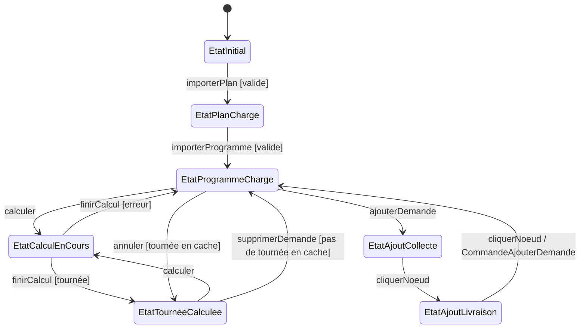
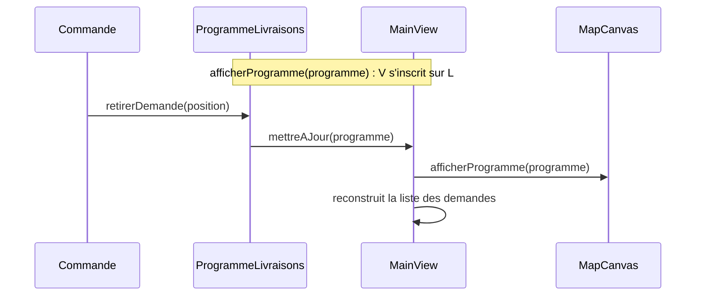
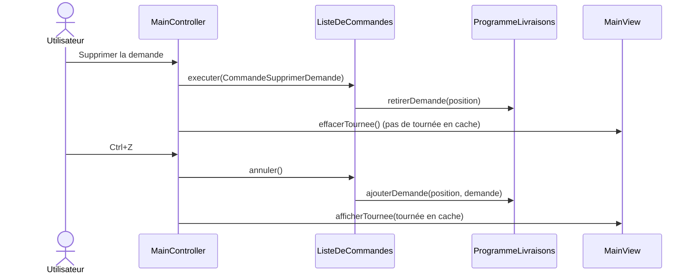

# Diagrammes (schémas du logiciel)

Seules les sources PlantUML (`*.puml`) sont versionnées. Les images sont
publiées sur [GitHub Pages](https://tristanhp.github.io/Optimod-Lyon/) à chaque
merge sur `main`, jointes à chaque exécution de la CI (artefact `diagrammes`)
et générables en local avec `./scripts/render-diagrams.sh` (sortie dans
`docs/diagrams/out/`, ignoré par git : le rendu dépend des polices de la
machine).

| Diagramme | Source | Contenu |
| --- | --- | --- |
| Cas d'utilisation | [use-cases.puml](use-cases.puml) | Ce que l'utilisateur peut faire |
| Architecture MVC | [architecture-mvc.puml](architecture-mvc.puml) | Packages et sens des dépendances |
| Classes | [classes.puml](classes.puml) | Modèle, contrôleur (états, commandes), vue |
| États du contrôleur | [etats-controleur.puml](etats-controleur.puml) | Design pattern State |
| Charger le plan | [sequence-chargement-plan.puml](sequence-chargement-plan.puml) | Séquence |
| Charger le programme | [sequence-chargement-programme.puml](sequence-chargement-programme.puml) | Séquence |
| Calculer la tournée | [sequence-calcul-tournee.puml](sequence-calcul-tournee.puml) | Séquence |

Règles : les diagrammes qui ne sont pas de séquence contiennent
`!pragma layout smetana` (rendu identique partout, sans Graphviz) ; on met à
jour le diagramme concerné dans la même PR que le code. Le vocabulaire est
celui du glossaire (voir le [README](../../README.md#glossaire)).

Les trois schémas ci-dessous résument les design patterns ; ils sont en
Mermaid pour être lisibles directement sur GitHub.

## État du contrôleur (State)

`MainController` délègue chaque action à son état courant, qui décide si
l'action est permise, quels boutons sont actifs et quel est l'état suivant
([ADR 0002](../adr/0002-design-pattern-state-controleur.md)).

## Observation du programme (Observer)

`ProgrammeLivraisons` prévient ses observateurs à chaque ajout ou retrait de
demande ; `MainView` se redessine seule
([ADR 0003](../adr/0003-design-pattern-observer-modele-vue.md)).

## Annuler une modification (Command)

Chaque modification est une `Commande` gardée dans `ListeDeCommandes` ; les
tournées calculées restent en cache, indexées par la liste des demandes
([ADR 0004](../adr/0004-design-pattern-command-annulation.md)).

